# Claude Code Chat Log — Discrete Op-Amp Educational PCB

Every prompt, verbatim (minor typos fixed), followed by the response as it was given, with the
renders as they were at the time (kept under `docs/history/`).  Model: Claude Fable 5.1.

## Prompt 1

> I want you to build a relatively inexpensive educational Op-Amp PCB out of discrete transistors that I'll order from JLCPCB using only components that they have available and in stock. The performance doesn't need to be great, but it should work as intended in basic op amp circuits. Record this prompt as Prompt 1 in CLAUDE_CODE_CHAT.md and record your response there and in the chat. Look at the other PCBs in ~/mudd/pcbs and ~/OpticsPCBs for recent examples. Follow the advice in ~/OpticsPCBs/CLAUDE_PCB.md and feel free to add to that document anything you learn while doing this. Feel free to use ~/.local/bin/kicad-10.0.7-x86_64.AppImage. The goal is an educational PCB. The silkscreen should look exactly like the schematic in that it the transistors should be arranged and rotated just like in a typical op-amp schematic, silkscreen should be drawn to clearly indicate what is what. Inputs and outputs and power should be screw terminals or BNCs where appropriate. I want you to make it out of the NPN and PNP transistors from Chapter 4 of Learning the Art of Electronics, which I've included as ~/mudd/pcbs/op-amp-pcb/datasheets_not_in_git/Tom_Hayes_Paul_Horowitz_Learning_the_Art_of_Electronics.pdf. Chapter 5 walks people through a design of an op amp with discrete transistors. I'd like you to follow that, though you should use individual discrete surface mount transistors to keep the silkscreen schematic looking like the schematic in the book. Another example of prior art on this is Evil Mad Scientist Laboratories, which has a discrete 741 design on a PCB, but their is more faithful to an existing chip, whereas ours is more for pedagogical purposes. I imagine that you'll select a 100mm x 100mm board for cost savings. The primary goal is clarity, simplicity, educational value, and ease of use for students in their first electronics lab class after having done most of chapter 4 in Learning the Art of Electronics.

Sent while the first response was being built:

> **1a.** Remember that the schematic should have an NPN or PNP symbol silkscreen right above (or around) the relevant NPN or PNP transistor. All of the wiring should be either blatantly obvious from the traces or silkscreened on. Intermediate surface-mount test loops for oscilloscope probes to clip onto should be liberally distributed on every trace worth probing.

> **1b.** As you make the schematics and board, show me screenshots and 3D renders here in the chat. Can you get away with a 2 layer board with all components on the top? 4 layer with all components on the top? Or do you need to do something more complicated and expensive? Make sure you include mounting holes in the corners for standoffs so that anything on the back side of the board does not get shorted or scratched.

> **1c.** Also, draw boxes with labels around things like "difference amplifier" and "push pull emitter follower" or however the book explains it.

> **1d.** On the silk screen, get rid of "Lab 5L" and add the github.com address where this checked out from. Maybe also a QR code to that address on the back, like you did for the ai-unleashes-chaos board in the same directory.

## Response 1

*2026-10-24, 09:51 to 12:13 PDT.*

**Two layers, all parts on top, is enough.**  Six transistors, three switches and
thirty passives on 100 x 100 mm leave most of the front empty; the back is one
unbroken ground plane with the text and the QR code on it, and M3 holes in the
four corners take standoffs.  Four layers would buy nothing.

### The circuit: Lab 5L's op-amp, kept, plus what a class needs

| stage | the book (Fig. 5L.15 and 5L.10) | on the board |
|---|---|---|
| difference amplifier | 2N3904 pair, 1.5 k collector load | Q1, Q2 MMBT3904, R3 1.5 k |
| tail | 10 k resistor, then the simple current sink 62 k / 10 k / 1 k | R4; Q6, R5, R6, R7; chosen by SW1 |
| gain stage | 2N3906 common emitter, 330 / 12 k | Q3 MMBT3906, R8, R9 |
| compensation | 100 pF collector to base of Q3 | C1 100 pF C0G, with R14 1 k in series (SW2 pole 2 shorts it) |
| output | 2N3904 / 2N3906 push-pull follower | Q4, Q5 |
| load / feedback | 10 k / 1 k divider, tap X to IN- for gain 11 | R10, R11; SW3 |

| addition | why |
|---|---|
| RV1 50 ohm trimmer between the emitters, wiper to the tail: OFFSET NULL | a discrete pair has millivolts of offset; null range +/-33 mV; a lifted wiper can only raise the resistance, never open the tail |
| R14 1 k in series with the Miller capacitor | the bare 100 pF leaves a right-half-plane zero: simulated follower phase margin -38 degrees (it oscillates); with the 1 k, +55 degrees.  The book's version stays on a switch |
| SW1 TAIL, SW2 COMPENSATION, SW3 FEEDBACK (2-way DIP switches) | the book's variants without loose jumpers: resistor or sink; with or without the 1 k; x11, follower or your own |
| R1, R2 1 k 1206 + D1, D2 1N4148W anti-parallel between the bases | a real op-amp's input clamps; a 2N3904's base-emitter breaks down at 6 V reverse |
| D3, D4 B5819W in series with the rails | a reversed bench supply does nothing |
| LED1, LED2 (green, 10 k) | rails at a glance |
| 17 RH-5019 SMT probe loops (3 of them ground) | a scope hook on every named node |
| BNC x3 (IN-, IN+, OUT) and KF301 screw terminals (IN-/GND, IN+/GND, OUT/GND, +15/GND/-15) | the generator and the scope on BNC; the student's own feedback network and the bench supply on screws |

Simulation (ngspice, `sim/opamp_sim.py`, results feed the sheet, the silkscreen and
the documents): tail 1.39 mA, Q3 1.30 mA; quiescent TAIL -0.66 V, Q2 C +13.9 V,
Q3 E +14.6 V, Q3 C +0.48 V, OUT 0.0 V; small-signal open-loop gain 139 at the
quiescent point (the class-B output is barely on), x11 amplifier really 10.2;
follower PM 55 degrees, settles in 0.5 us; swing -14.3 / +13.5 V; common-mode gain of
stage 1 0.073 (resistor tail) vs 0.0004 (sink).

### The board as the schematic

Copper follows the drawn wires: `scripts/layout.py` holds one list of wires and
`gen_pcb.py` draws each as track and as silkscreen.  Three crossings are hops
(the track dives to the back between two vias, the silkscreen arcs over).  Every
transistor sits in a circle with the base bar and the emitter arrow derived from
its real pads (NPN out, PNP in); SOT-23s are placed collector-up (rotation 90), or
mirrored where the base arrives from the right (Q2, Q6).  Dashed boxes name the
stages: INPUT PROTECTION, DIFFERENCE AMPLIFIER x11, TAIL, GAIN x30, COMP., PUSH-PULL
x1.  No front pour.  Rails are 0.8 mm lines along the top and bottom.  Title, authors,
rev, date and the repository URL in the band under the -15 V rail; the user's
instructions and a QR code to github.com/gallicchio/op-amp-pcb on the back.

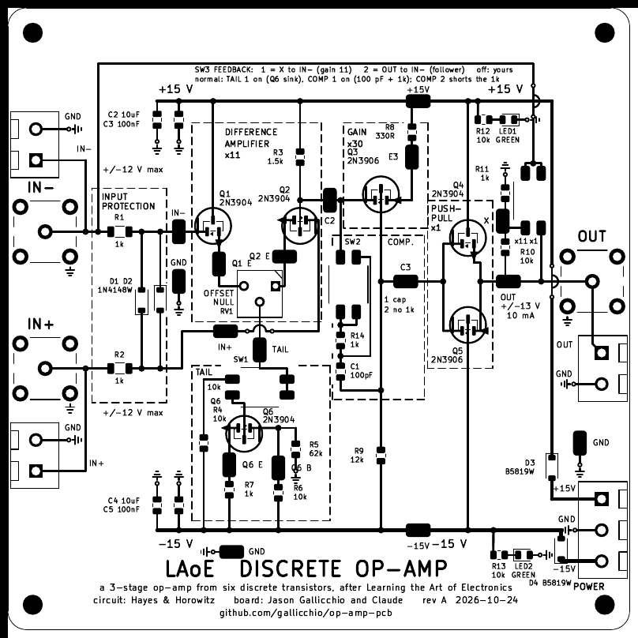
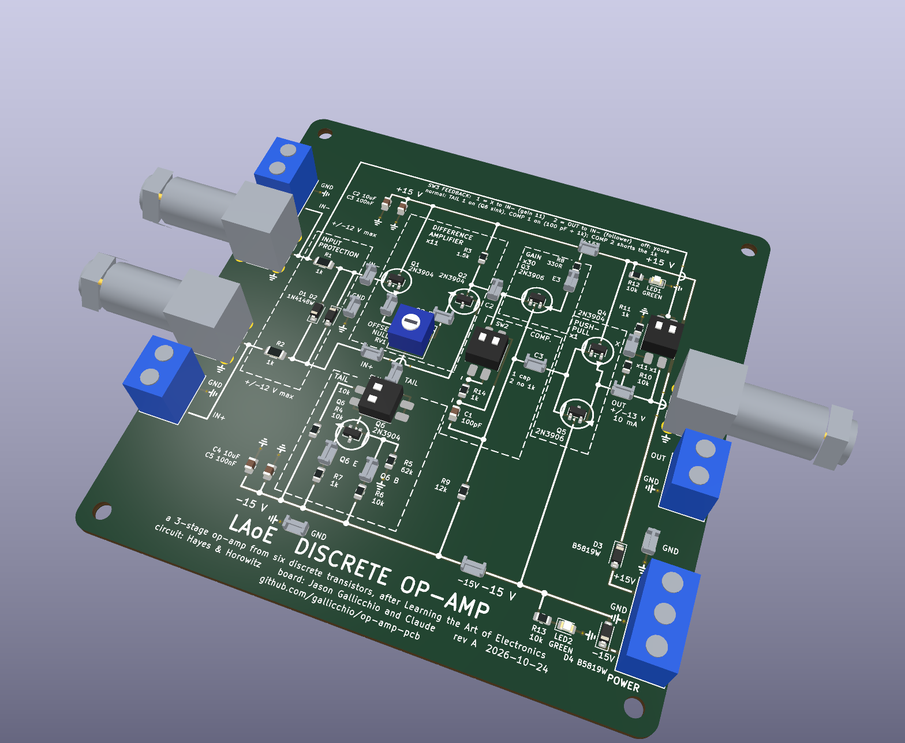
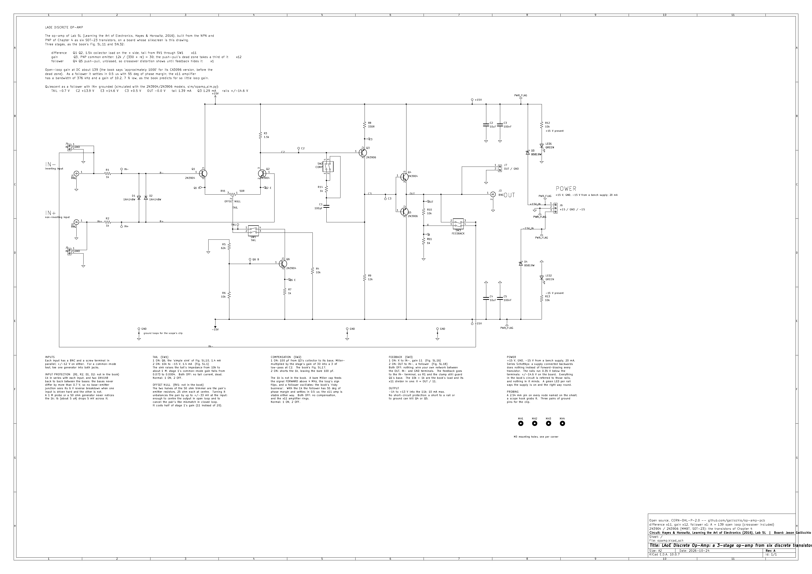

### Checks and files

ERC 0; DRC 0 with schematic parity; 91 netlist assertions (`check_circuit.py`) that
re-derive the book's circuit from the exported netlist; no schematic text overlaps;
fab package checked (gerber layers, 59 placements against 39 BOM lines, every LCSC
code's JLCPCB description matching value and package, the QR decoded back out of the
board file, the trimmer's hole pattern keyed).  `./make.py` builds all of it in about a
minute.  Parts $7.62 a board; about $66 for the first assembled board and $8 for each
further one (JLCPCB's fixed fees dominate).  `docs/MANUFACTURING.md`, `out/opamp/`.

### What could be dead on arrival

1. The six SOT-23s turned a half turn: JLCPCB's drawing has pin 1 where KiCad has
   pin 3, so the upload CPL turns them +180, predicted from their land pattern and
   not yet read in a preview.  `PLACEMENT_CHECKS.txt`; the 4 mA per rail bring-up step
   catches it.
2. A DIP switch turned: electrically symmetric, harmless.
3. Ringing with a metre of coax on OUT; 55 degrees is the simulation's margin.
4. A shorted output kills Q4 or Q5: no current limit (rev B list).

## Prompt 2

> Can this be used as an opamp in an external circuit too? Like an integrator or photodiode current to voltage converter or an LED constant current source? (If both the 1x and 10x switches are off, for example?) Also, "tail" should indicate that the transistor is there to make a constant current source. Other labels like "comp" should be full words, even if they need to be rotated. This is for people who have never seen this material. It might even be used as a quick bridge between chapters 4 and 6 for a class with limited time -- I want to show students that opamps aren't magic (just made of transistors) but we don't have time to do all of lab 5. Could this be used for the first few circuits in lab 6 and 7 and maybe even 8? Are there small tweaks that don't add complexity that would allow this to function as an opamp in some of the circuits in the op amp chapters?

## Prompt 3

> (Keep recording all of these prompts in the CLAUDE_CODE_CHAT.md document along with your replies and screenshots and renders.)

## Prompt 4

> Being a "bad" integrator isn't the end of the world. Seeing and measuring drift current is part of lab 7 anyway. In fact, the 411 is almost "too good" to see these op amp non-idealities in some cases. As long as it doesn't run away in a tiny fraction of a second (and can't be fixed with a bigger capacitor), I'm perfectly happy with a "not very good op-amp" that is made of real discrete transistors that the students can see and poke at.

## Response 2

*2026-10-24, 12:25 to 12:55 PDT.*

**Yes: with both FEEDBACK sliders off it is a bare op-amp** on the IN-, IN+, OUT and
GND terminals, and I read the actual Lab 6L, 7L, 8L and 9L circuits out of the book's
PDF to judge each against its real numbers.  The numbers that matter: input bias
current about 2 uA (a BJT pair at 0.7 mA a side, beta 300; the '411 has 50 pA, the 741
80 nA); differential input impedance about 20 k plus the 1 k series resistors; open-loop
gain 140 at rest, a few hundred once the output moves; output +/-13 V into 1 k and up,
**no current limit** where the '411 has 25 mA; slew rate several V/us; the anti-parallel
clamp conducts when the inputs differ by more than 0.7 V (current limited by the 1 k's).

| book circuit | verdict | why |
|---|---|---|
| 6L.2 open-loop test | yes, better than with a '411 | gain of a few hundred: students can actually find the 50 mV window where OUT is not pinned |
| 6L.3 follower, Zout with the 1 k and feedback #2 | yes | FEEDBACK 2 is this circuit; the Zin test with a 1 M in series shows 2 V of bias-current drop instead, which is the lesson |
| 6L.4 non-inverting x11 | yes | FEEDBACK 1 is exactly Fig. 6L.7 (the book's own footnote points back to Lab 5L); gain 10.2, the finite-gain error |
| 6L.5 inverting -10, 6L.6 summing | yes | summing junction on the IN- terminal; the 1 k inside the loop costs 2 mV of offset |
| 6L.8 push-pull buffer with 3055/2955 | yes, modest amplitude | base drive of 10 mA is fine; the same crossover demonstration the board does inside itself |
| 6L.9 photodiode with 10 M | **no** | 2 uA x 10 M = 20 V; even 1 M gives 2 V of drifting offset.  The phototransistor version with 100 k: yes, 0.2 V offset |
| 6L.10 current source (floating 1 k load; 2N3906 + load to ground) | yes | the op-amp only supplies base current; an LED at 10-20 mA is the second circuit exactly |
| 7L.1 integrator (10 M leak, '411) | yes as a bias-current demonstration, with a bigger C | drift Ib/C: 230 V/s with 10 nF (rails in 60 ms), 23 V/s with 100 nF, 2.3 V/s with 1 uF (the 1 s/div sweep the book asks for); the 10 M leak pins the output, use 1 M or none; the reset button works |
| 7L.2 differentiator, 7L.3 slew rate | yes | slew rate lands between the 741's 0.5 and the '411's 15 V/us: a third data point |
| 7L.4 single-supply '358 at +5 V | no | needs both rails |
| 8L.1 comparator at 100 kHz | yes | slews as the book says it should |
| 8L.1.3 Schmitt trigger, 8L.2 RC relaxation oscillator | yes, small hysteresis | thresholds of +/-0.67 V sit at the clamp's knee; with volts of hysteresis the clamp loads a 10 k divider |
| 8L.7 Wien bridge with the lamp | yes at modest amplitude | 15 mA of output current at full swing is the ceiling |
| 9L.3 instability with capacitive loads, 9L.4 buffer in the loop | yes | it has 55 degrees of margin to lose |

Prompt 4 settles the integrator: it drifts at 2 uA / C, a bigger capacitor tames it to
volts per second, and the drift is the measurement.  Nothing on the board needs changing
for it.

**Tweaks.**  Done now, no parts added: TAIL box gains "CURRENT SOURCE" (standing up its
left side), "COMP." became "COMPENSATION" (standing), "GAIN STAGE x30", "PUSH-PULL
FOLLOWER x1", switch poles read "1: Q6 / 2: 10k" and "1: 100pF + 1k / 2: no 1k", the top
band spells the switches out in words, and the probe loops C2 / E3 / C3 are now Q2 C /
Q3 E / Q3 C (there is a capacitor called C2 on the board; the schematic labels, the
netlist, the circuit checker and the handbook all use the new names).  The back of the
board now says how to use it as a bare op-amp, with its two limits.  The one tweak worth
adding parts for is an **output current limit**: two more transistors and two 39 ohm
resistors in the push-pull, the 741's own scheme, limiting to about 15 mA so a shorted
OUT survives.  Students will short the output in Lab 6; the '411 shrugs, this board
loses Q4 or Q5.  It adds two circles to the PUSH-PULL box and a new lesson ("why your
op-amp has a current limit").  Not done; it is a change to the book's circuit, so it is
Jason's call.  Not worth doing: anything about the bias current (a Darlington input or a
lower tail current each costs more than it buys).

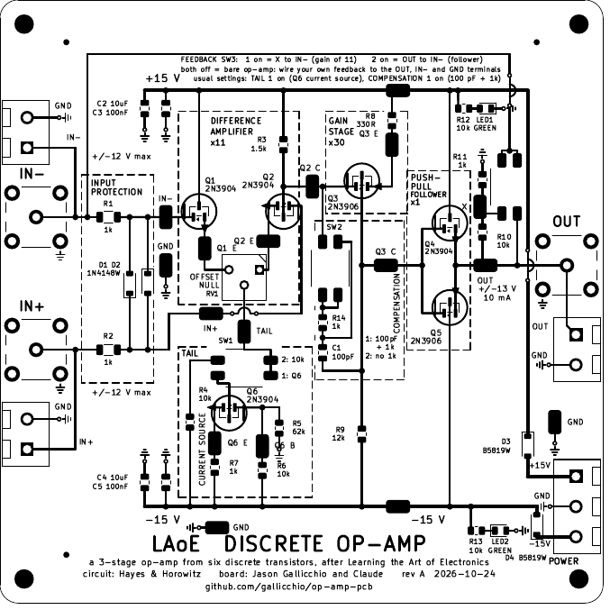
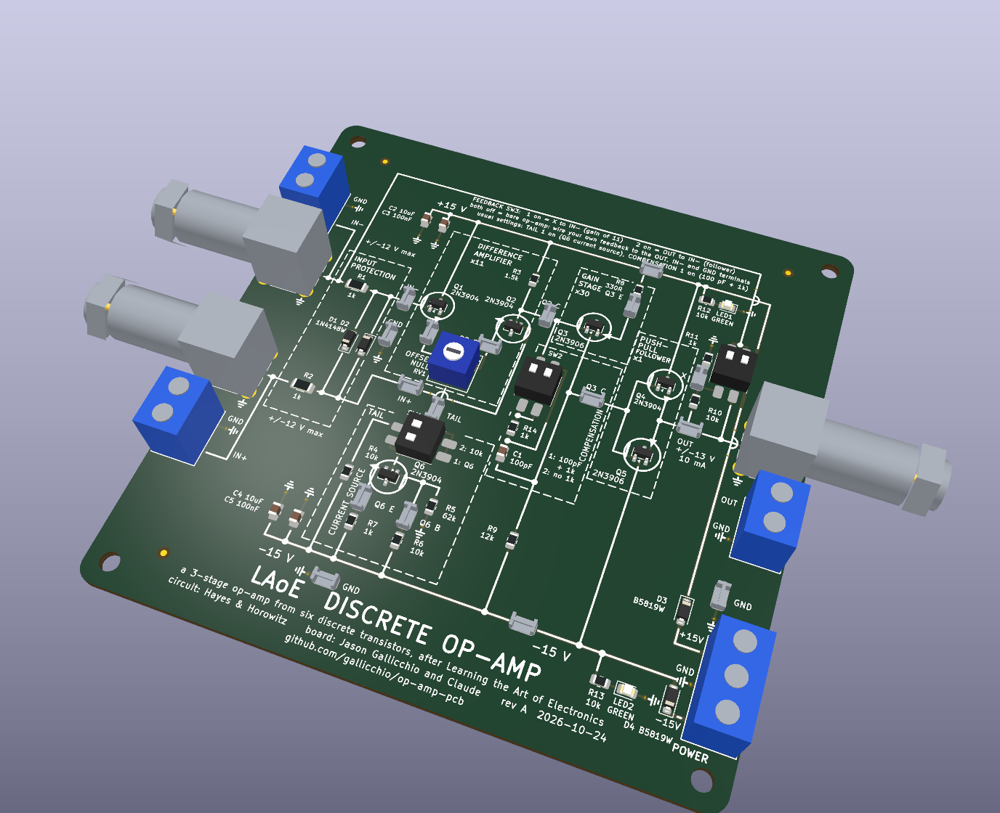
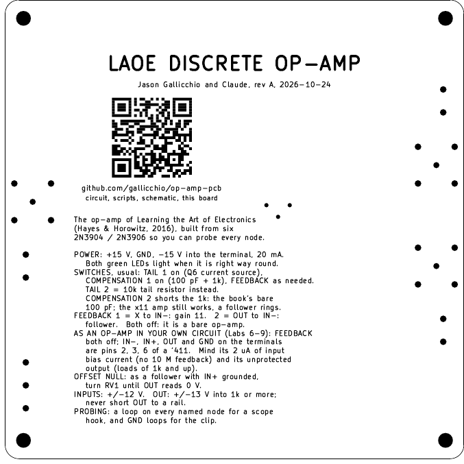
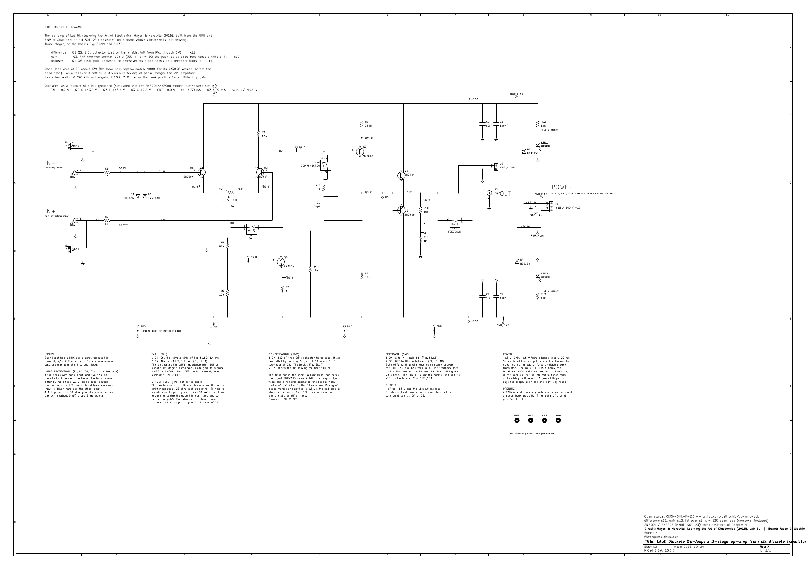

Also in this response: three fiducials; `docs/HANDBOOK.md` (power, switches, the
voltage at every loop, bring-up, exercises in Lab 5L's order), `docs/DESIGN_NOTES.md`,
`docs/MANUFACTURING.md` with JLCPCB's order form field by field and
`out/opamp/PLACEMENT_CHECKS.txt`; `LICENSE` (CERN-OHL-P-2.0 hardware, MIT scripts);
lessons written into `~/OpticsPCBs/CLAUDE_PCB.md`.  Build: ERC 0, DRC 0, 91 circuit
checks, fab checks all pass, 25 of 25 document claims match the build.

## Prompt 5

> Don't say "LAOE" Say "Learning the Art of Electronics" on its own line or just say "DISCRETE TRANSISTOR OP-AMP" because the first line of text says "Learning the Art of Electronics"
>
> Make many more ground clips: up to 4 total for 4 channels of oscilloscope.
>
> The "IN+" probe should be symmetric with the "IN-", probably rotated vertically and placed below it. The switch in the tail should say "10k" as it does, but the other one should say some version of "current source", even if you need two lines or smaller text.
>
> Your transistor symbols are not great. In particular, the "arrows" on your transistor symbols aren't that great. They need to be inside of the circles. It should be very obvious from looking at each transistor whether it's NPN or PNP, and which pin is the emitter, base, and collector. That's not obvious now. Actually look at the area around each transistor for this. Did you really pick the rotation of each transistor to be optimally understandable when a student looks at the "schematic" printed on the PCB?
>
> Sometimes you have ground symbols pointing "up" like near the label for R11. Move things around so that the ground symbols always point down. The exception to that might be for the decoupling capacitors for the -15V, where ground really is "above" -15V.
>
> Is there no "±" plus-or-minus symbol that you can use (or draw yourself) for things like the "+/-13 V" output range and the "+/-12 V max" input range?
>
> What is the "B5819W" text doing so close to the "POWER" label near the screw terminals? Move that somewhere else, maybe touching the top left of that component. Why is there a GND symbol next to the power terminals on the same white silkscreen line labeled -15V elsewhere?
>
> Could you make the LEDs and their resistors hang "down" from the +15V" toward ground and "up" from the -15V line up to ground? (Like you did with the decoupling capacitors.)

## Prompt 6

> Finally, you have some text at the top of the PCB that describes what each switch does. It would be better if the relevant text were in a box near each of the switches. In general (and this should go in CLAUDE_PCB.md), if you can label something where it is relevant, it's *much* easier for humans to read than labeling it somewhere else with its reference designator. I don't want to have to read something on the top and say to myself, "Okay, now which switch is SW3?", nor do I want to see a switch (or group of switches) and say to myself, "Okay, now where is the function of this described?"

## Prompt 7

> If you can make the "output current limiter" into its own box that makes it clear to the students that this is only a safety feature and does not change the function of the circuit, I agree that you should add that. If it becomes impossible to fit in the existing 100mm x 100mm board without making everything else unreadable, we can revisit the choice of doing this or of keeping that board size. What is your estimated cost per board for 10 or 20 boards? Should I do my normal "5 PCBs with 2 assembled", or is this so likely to work and the parts so inexpensive that it's worth just making 5, 10, or 20 fully assembled the first time?

## Prompt 8

> When you are done, show me the new version of the silkscreen here, especially around each transistor with some context.

## Prompt 9

> Those transistor symbols are still really confusing. They don't look like the transistor symbols in the Art of Electronics. Isn't the arrow always the emitter, for both NPN and PNP? Sometimes your arrow has a C next to it.

## Response 3

*2026-10-24, 13:00 to 16:40 PDT.*  Prompts 5 to 9 together.

**The output current limit is in** (Prompt 7), in its own dashed box, OUTPUT CURRENT
LIMIT, to the right of the push-pull: 47 ohm in each emitter (R15, R16), Q7 and Q8
sensing them, and D5, D6.  The diodes are not in a 741: with the book's bare class-B
pair the two bases are tied, so while one half conducts the idle sense transistor's
base sits a Vbe above its collector, the junction conducts, and the simulation's
negative swing collapsed from -14 V to -9 V.  A 1N4148 in series with each sense
collector blocks that and costs nothing at the limit.  Simulated: 22 mA into a dead
short, swing -14.3 / +13.4 V, follower phase margin 51 degrees (was 55).  97 circuit
assertions now, including the limiter's wiring and its limit.

**Transistor symbols** (Prompts 5 and 9): drawn again from the book's picture.  Inside
each 3 mm circle: a vertical base bar on the side the base arrives from, two legs
leaving the bar near its ends, the collector leg to the collector wire and the
emitter leg to the emitter wire, with a filled arrowhead that is always on the
emitter: at the leg's far end pointing out for an NPN, at the bar pointing in for a
PNP.  B, C and E are lettered where the three wires leave the circle, the package's
own silkscreen rectangle is gone, and the emitter wire of each transistor is brought
out exactly where the symbol's leg ends (a short jog under the package).  The "C
next to an arrow" was a sign error in the first version of this code, which put the
arrow on the collector leg of every NPN; the picture Jason saw was that build.
The types are stated once in the title band ("Q1 Q2 Q4 Q6 Q7 = 2N3904 NPN,
Q3 Q5 Q8 = 2N3906 PNP").  Rotations: every transistor sits so its base arrives from
the side its driver is on and its collector and emitter leave up and down as the
book draws them (NPN collector up; PNP emitter up); Q2 and Q6 are mirrored because
their bases come from the right.

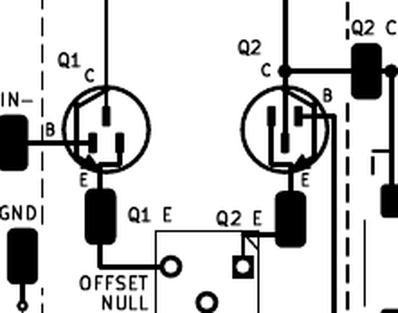
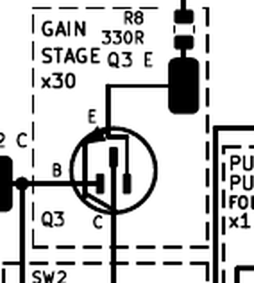
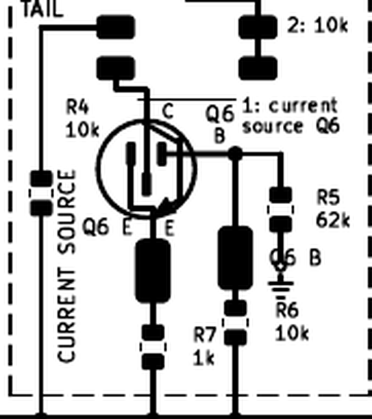
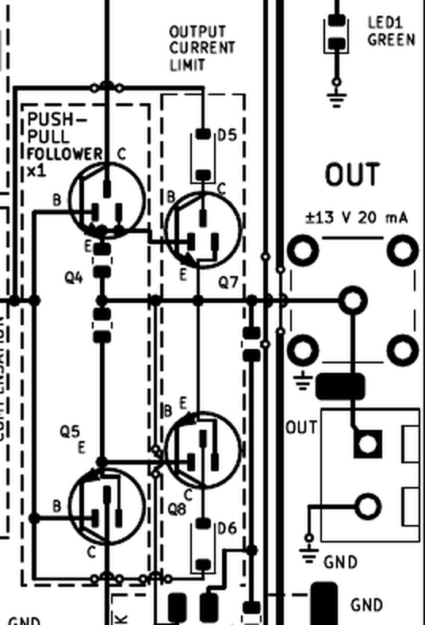

**Everything else from Prompt 5 and 6:**

| asked | done |
|---|---|
| no "LAoE" | title is DISCRETE TRANSISTOR OP-AMP; the next line names the book; the back's first line already did |
| four ground loops | TP100-TP103, one per scope channel, each with a ground symbol pointing down |
| IN+ loop symmetric with IN- | both vertical loops at x = 26.8 on their input lines, labels above IN- and below IN+ |
| tail switch words | "2: 10k" and "1: current source Q6"; CURRENT SOURCE stands up the TAIL box |
| grounds point down | every ground symbol hangs down from its via, including the output divider (now below the OUT line) and the connector grounds (stubs turn a corner); the exception is the -15 V lamp and bypass, whose ground is above |
| ± | "±12 V max", "±13 V 20 mA" (KiCad's stroke font has it) |
| B5819W by POWER | D4 turned horizontal, its name at its top left; D3 keeps its name |
| GND on the -15 V line | the -15 V rail now ends at D4; J6 sits 2 mm lower and its ground leaves the body, turns and hangs down |
| lamps hang from the rails | R12 / LED1 down from +15 V at the right edge; R13 / LED2 up from -15 V beside the TAIL box |
| switch text at the switch (Prompt 6) | FEEDBACK has its own box with "1: X to IN- (gain 11) / 2: OUT to IN- (x1) / off: bare op-amp" under the switch; COMPENSATION and the tail legend were already in their boxes; the band above the +15 V rail is gone |

The right-hand third of the board was re-planned for the limiter: eight hops now
(three before).  Not labelled on the board for lack of room: R10 and R11 (the
FEEDBACK legend says gain 11) and R15, R16 (47 ohm, in the handbook).  The X node
lost its probe loop; the handbook says where to probe it.  ERC 0, DRC 0, fab checks
pass, 28 of 28 document claims match.

**Cost (Prompt 7)**, JLCPCB list prices, parts $7.68 a board, from `docs/MANUFACTURING.md`:

| assembled boards | total | each |
|---|---|---|
| 2 (5 PCBs) | $75 | $37 |
| 5 | $100 | $20 |
| 10 | $145 | $15 |
| 20 | $233 | $12 |

The fixed fees ($8 setup, $1.50 stencil, $3.58 through-hole setup, 7 x $3 extended
parts, $22 DHL) are two thirds of a two-board order.  Recommendation: order 10
assembled, not 5 PCBs with 2 assembled.  The circuit is simulated as fitted, the
netlist is checked against the book line by line, the only parts a preview can turn
are listed in PLACEMENT_CHECKS.txt and each of them is either keyed, symmetric or
read on a previous board except the SOT-23s, which a 4 mA-per-rail bring-up check
catches, and a rev B would cost a second $60 of fixed fees anyway.  Ten boards is a
class set for $145; the eight extra boards cost $8 each.

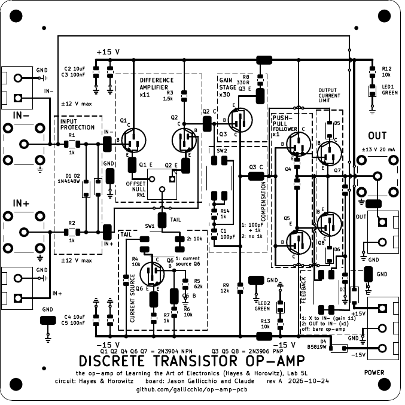

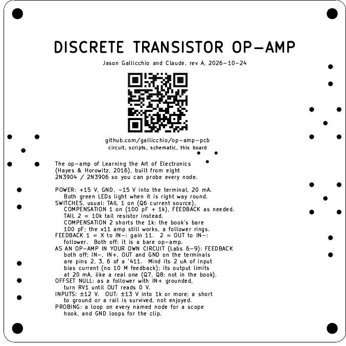
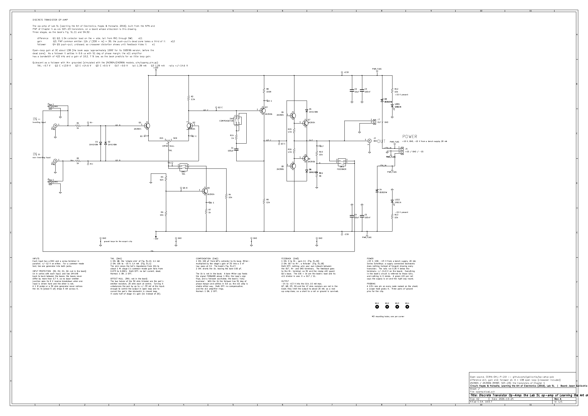

Lessons written to `~/OpticsPCBs/CLAUDE_PCB.md`: label a thing where it is, never by
designator elsewhere (Prompt 6, in Jason's words); the transistor symbol a novice
can read; grounds point down; the class-B limiter needs its diodes; a drawn symbol
replaces the footprint's outline; and the cost of adding six parts to a finished
board.

## Prompt 10

> There is a component right on the border of the "OUTPUT CURRENT LIMIT" box and the
> "FEEDBACK" box that prevents the bottom of the  "OUTPUT CURRENT LIMIT" box and the
> top of the "FEEDBACK" box from being drawn. Move that component down into the
> feedback box if it belongs there, or move everything in the "PUSH-PULL FOLLOWER"
> AND "OUTPUT CURRENT LIMIT" boxes up a bit.
>
> The transistor symbol still looks bad. The vertical line where the base comes in,
> the emitter arrow, and the collector's line should all be more well within the
> circle. Maybe the circle just needs to be bigger. The "E", "B", and "C" labels can
> be inside of the circle. The 3 SMT pads themselves also awkwardly connect to the
> symbol lines, especially for E and C. It's good to show those connections, but on
> the silkscreen, make them much thinner than the lines for the symbol itself.

## Response 4

**The border.** The culprit was the FEEDBACK switch: its courtyard reached 0.2 mm below
the limiter box, and the box generator clips its dashes round every courtyard, so the
bottom edge of the OUTPUT CURRENT LIMIT box and the top edge of the FEEDBACK box were
both erased along the switch.  Rather than nudge one part, the right-hand third is
re-planned, which the bigger transistor symbols needed anyway:

- The push-pull and limiter boxes now end at y = 57.8 and the feedback box starts at
  59.4, with the limiter's lower diode return running along the clear band between
  them; its upper return runs above the push-pull box the same way.  Both boxes keep
  all four edges.
- The 10 k / 1 k divider moved from beside the limiter into the FEEDBACK box, which is
  where it belongs: OUT comes down between the two boxes into R10, X is the tap with
  its own loop again (TP10), R11 hangs from X to ground, and the switch, turned so its
  inputs face left, takes X straight down into pin 1 and OUT round the left into pin 2.
  R10 and R11 are labelled again ("R10 10k", "R11 1k"); so are R15 and R16 ("47R").
- The limiter's title says what it is in full: OUTPUT CURRENT LIMIT, a safety net, not
  in book.
- Q4's collector steps 4 mm left before rising to +15 V so that "PUSH-PULL FOLLOWER"
  fits in the box's top band without a wire through it.

**The transistor symbol**, drawn again from the book's picture (Fig. 5L.15 was
rendered at 200 dpi and copied):

- The circle is r 4.0 mm (was 3.0) with a thinner ring (0.25 mm) than the symbol
  (0.45 mm leads, 0.55 mm bar).  The base bar is 2.2 mm from the centre, 2.8 mm long;
  the legs leave its ends at 45 degrees, turn vertical at 3.6 mm and leave the circle
  straight above and below the package, so the wires outside are straight lines.  The
  arrowhead is on the emitter leg: outward at its end for an NPN, against the bar for a
  PNP.
- B, C and E are 0.8 mm letters inside the circle, in the three corners the symbol
  leaves empty.
- Each pad is joined to its lead by a 0.16 mm hairline, square on to the leg, and the
  copper follows the hairline and the lead out to the circle, so the wire, the drawn
  symbol and the pad are one conductor.  For an NPN with its base from the left every
  pad lies under its own lead.  For a PNP (and for Q2 and Q6, whose bases come from the
  right) the lone collector pad sits under the emitter leg; its hairline runs down
  between the other two pads to the collector leg, and the emitter's goes round the
  side.  The other package rotations were tried on paper and put a pad where its copper
  cannot reach without crossing another lead.
- The footprint's own outline is gone; the wires stop at the ring (the ring is a
  keep-out for the wire clipper) and a wire reaches the ring square on: Q2's base
  riser now turns horizontal 1.4 mm before the circle instead of grazing it.

Around the symbols: Q1 and Q2 sit 0.4 mm lower and 0.4 mm apart from where they were,
their emitter loops turned flat under them; R3 and the Q2 C loop moved up; R8 stands
straight above Q3 as the book draws the 330, with the Q3 E loop between them; Q6 and
R7 moved 0.5 mm down; the TAIL's 10 k moved left; the COMPENSATION legend stands up
the box's side as one line; the two ground loops that were in the way (TP100, TP103)
moved to clear ground; the left side's input clamp moved 0.4 mm left to give the IN-
and IN+ loops room for their names.

What the build says: ERC 0, DRC 0 with KiCad's silkscreen rules on (0.8 mm minimum
text, 0.15 mm silk-to-silk clearance, 53 violations on the first pass, all placement),
98 circuit checks (one more: TP10 is X), fab checks pass, 28 of 28 document claims
match.  Eight hops as before (Q4's collector hops under the limiter's bus instead of
the bus under it).  Parts $7.78 a board (the loop added a dime); 10 assembled boards
$146.17, $14.62 each.

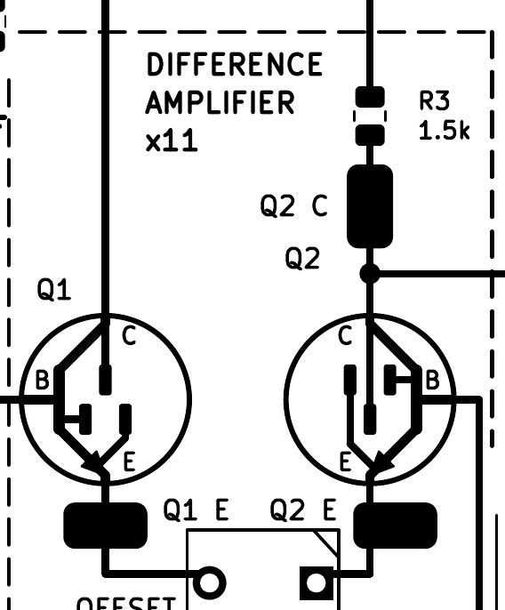
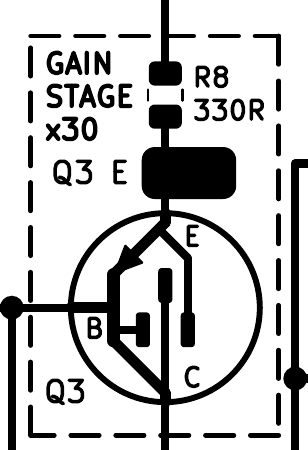
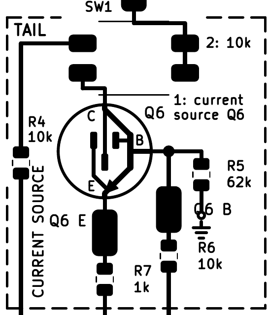
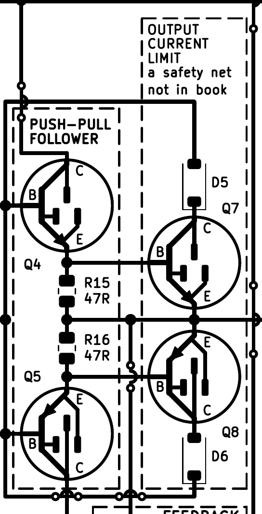
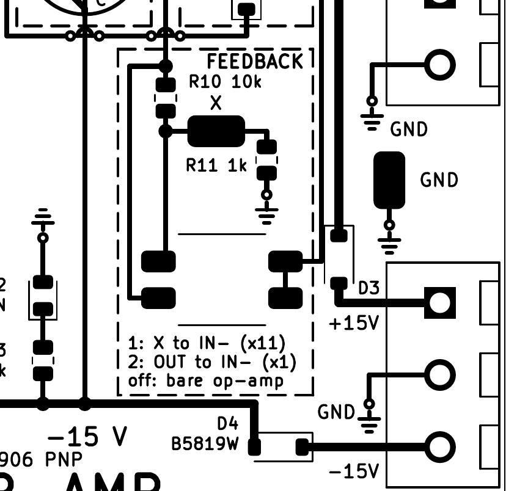
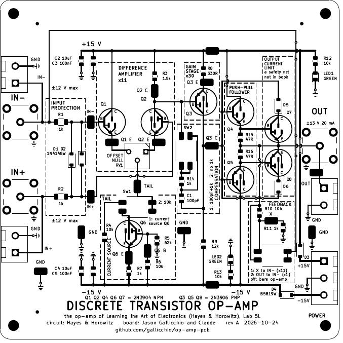
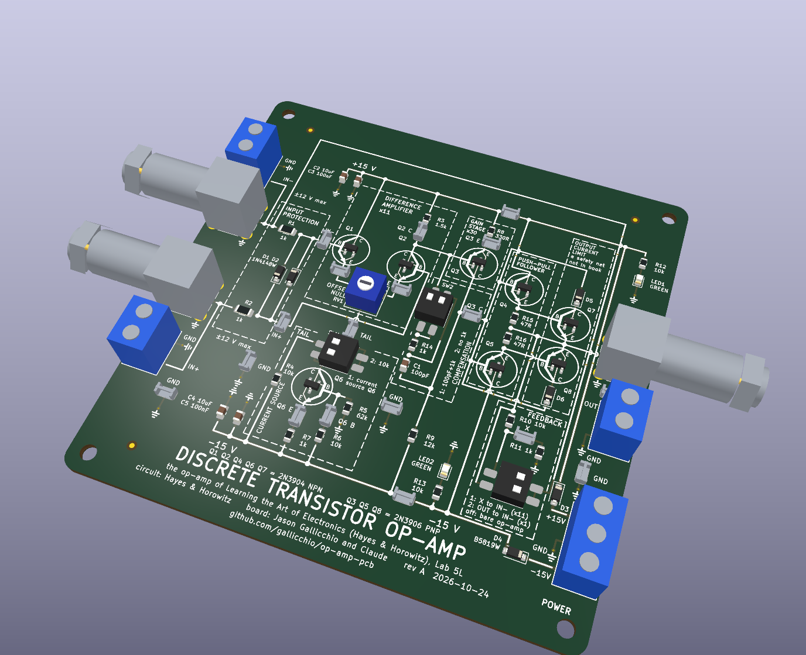
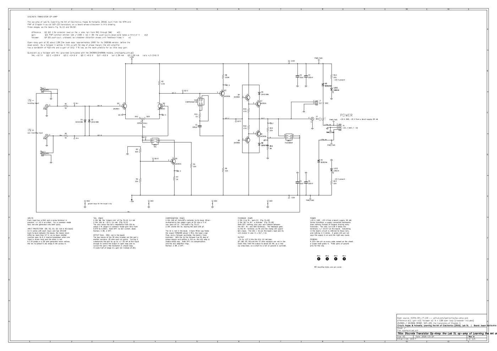

Lessons written to `~/OpticsPCBs/CLAUDE_PCB.md`: the symbol geometry that works round
a SOT-23 and why the package rotations are what they are; KiCad's stroke font is as
wide as it is tall (measure, do not estimate); nothing sits on a box edge and buses
run along the band between boxes; a wire through a title band gets a jog.

## Prompt 11

> Make a new directory called design_reviews and make a prompt to send to other LLMs to
> do a design review. They should make a new directory within this design_reviews
> directory that includes the date and their name. They should write a report in their
> own directory and only ever modify files within their own directory, since many agents
> will be doing the review at the same time. If they need to copy or clone any part of
> this project, they should do it in their own directory. Some of these instructions are
> in CLAUDE_PCB.md in OpticsPCBs, and you should read those instructions and update them
> as necessary. There are other examples of design review prompts that you can build on
> in the other PCB projects that I pointed you to initially. When you are done writing
> the prompt, you follow the prompt to do the design review yourself.

## Response 5

2026-10-24 23:00 to 2026-10-25 00:30 PDT.

**The brief.** `design_reviews/DESIGN_REVIEW_PROMPT.md`, built on the gps-gh-adapters
brief, the OWL review package and the Lorenz board's self-review, with the rules from
`CLAUDE_PCB.md`: in bold first, only files count; each reviewer in
`design_reviews/<YYYY-MM-DD>_<Model-Version>/` with `REPORT.md` and a gitignored
`project/` copy to build in (the `rsync` line is in the brief, and `.gitignore` now has
`/design_reviews/*/project/`); what the build rewrites, so "do not run it in place" is
concrete; the claim to break with the board's own numbers; eight numbered things to
attack with the file to read for each; the rules file's points as checks; a tools table
with what each command writes; what is already known or decided; and the report's
sections. `design_reviews/README.md` explains the layout and indexes the rounds.
`~/OpticsPCBs/CLAUDE_PCB.md`'s outside-reviews bullet now describes this convention
(dated directories under one `design_reviews/`, a later date for a later round, the
author's own review in the same place) and names this brief as the template.

**The review.** Done as the brief says, in `design_reviews/2026-10-24_Claude-Fable-5.1/`,
before reading anyone else's: a fresh copy rebuilt there (byte-identical to the
committed files except the STEP and the raytrace), every net printed and read against
the book, the land pattern of every non-passive code fetched from JLCPCB and compared
with the footprints, the CPL angles re-derived, the DIP switch's and the stocked
transistor's datasheets read, and two simulation scripts asking what the project's
simulation had not been asked. `REPORT.md` there has eleven findings; the ones that
matter:

1. **COMPENSATION 2 on its own is no compensation at all** (major). Pole 2 shorts R14,
   but the chain Q2 C -> pole 1 -> R14 -> C1 is open unless pole 1 is on, so "2 =
   the book's bare 100 pF", which the back of the board, the sheet and the handbook
   all say, is false; the bare capacitor needs both sliders, which nothing says. The
   checker's assertion "pole 2 shorts R14" was true and did not catch it. The
   simulation says what the student would have seen in exercise 8: the x11 amplifier
   with 18 degrees of margin and a 54 % overshoot, twice. Fix: pole 2 from Q2 C
   straight to the R14 / C1 junction, on the sheet and the board; then 1, 2 and both
   do what the legends say.
2. **"A short to a rail is survived" is false for the part JLCPCB stocks** (major).
   The limiter holds Q4 or Q5 at 14.5 mA (the 22 mA is the total into the short, the
   rest through the sense transistor): 0.21 W into a short to ground, 0.43 W into a
   short to a rail, in a SOT-23 whose C20526 datasheet says 200 mW and 625 K/W. Ground:
   minutes. A rail: seconds. Fix: words; 100 ohm sense resistors would make a rail
   short survivable at the cost of +/-6.5 V into 1 k, not recommended.
3. **A scope's ground clip on Q2 C or Q3 E puts 0.55 to 0.68 W into the 0805 R8**
   (major); on Q6 E or Q6 B, 0.2 W into R7. A 50 mA limit on the bench supply ends the
   R8 cases, and nothing on the board or in the handbook asks for it after bring-up.
   Fix: the limit as the rule, on the back silk and in the handbook.
4. The DIP switches have no ON mark, and "On is toward the number" is not true as
   drawn (SW1's ON side is away from its legends); the preview check has nothing to
   compare against. Fix: silk ON marks on the footprint's ON side, and the preview
   check against the part's own ON marking.
5. Cable capacitance on OUT does not destabilise the follower in the model (100 pF
   raises the margin from 51 to 90 degrees; 10 nF leaves 30); the rev B "47 ohm in
   series" item is moot. A 10x probe on Q3 C or Q2 C is what eats margin (39, 35,
   both 25 degrees): still stable, no overshoot.
6. Stale numbers: six transistors in four places, 55 degrees twice, three null
   ranges (33 / 37 / 19 mV), two input-resistor powers (the truth: 51 mW with one input
   at a rail, 214 mW with both at opposite rails), stage 2's gain attributed as 12.5
   when it is 34 at Q3 C times the push-pull's 0.37 at rest, "no fiducials" when
   there are three, "2.54 mm pins" on the sheet.

Found right: the circuit, the sense of every stage, every diode's polarity, the SOT-23
pin order and the package rotations, every JLCPCB correction against JLCPCB's own land
patterns, every custom footprint against them, the DIP's poles across the body, the
handbook's loop voltages, the null range, the input protection (no junction ever
reversed by more than 0.02 V), the slew rate (4.4 V/us), Economic PCBA taking the
through-hole parts.

**The patch.** `patch_round1.diff` in the review directory does findings 1 to 7 and
builds clean in the copy: ERC 0, 102 circuit assertions (Q7 and Q8 added), DRC 0,
28 of 28 claims. The project itself is unchanged: the brief says reviewers do not touch
it while a round runs, and that holds for this one. Renders of the patched switch area
and sheet are beside the report (`zp_*.png`).

**Next.** Send the brief; when the round is in, reconcile by evidence and apply the
patch (or its findings) through the generators, then rebuild. Lessons added to
`CLAUDE_PCB.md`: derive what each switch position does on its own from the netlist, not
from intent; mark ON on the silk and check it in the preview; a teaching board's bench
supply limit is part of the design, computed from a ground clip on every loop; check
the stocked part's ratings, not the famous maker's.

## Prompt 12

> No other agents have done a review, so you should apply your fixes now before I start
> the other agents. I'll wait.

## Response 6

2026-10-25 00:35 to 01:05 PDT.

Applied `design_reviews/2026-10-24_Claude-Fable-5.1/patch_round1.diff` to the project
(it applied cleanly, as the dry run had said) and fixed the review's finding 9 as well:
the ground stubs of the two input terminals now turn down 1.1 mm before their vias, so
their symbols point down like every other ground on the +15 V side. Rebuilt in place:
ERC 0, 102 circuit assertions (Q7 and Q8 now checked), no sheet overlaps, DRC 0 with
the silkscreen rules, fab checks, 28 of 28 document claims, BUILD OK.

What changed on the board and the sheet:

- **COMPENSATION.** Pole 2 now runs from Q2 C straight to the junction between R14 and
  C1. On the board the Q2 C drop forks at (53.5, 37.5) into both of SW2's upper pads
  and the lower right-hand pad runs down the switch's right side to the junction below
  R14; the "SW2" label moved to the right of the switch. On the sheet SW2's pin 3 rises
  to the Q2 C line and pin 2 drops to the R14 / C1 node. Position 1 is 100 pF + 1 k,
  position 2 is the bare 100 pF, both together the same as 2, as every legend says.
- **ON marks.** "ON" left of SW1's pads, above SW2's, and "ON>" above SW3's right-hand
  pads (the box edge leaves no room beside them). The handbook says "on is toward the
  word ON"; the preview check and the assembler note say to compare the part's own ON
  marking with it.
- **The back text.** POWER: "set the supply's limit to 50 mA"; COMPENSATION 2 is "the
  bare 100 pF, no 1k (the book's)"; OUT is "±12 V into 1k, 15 mA; a short to ground is
  survived, to a rail only for seconds".
- **The sheet notes.** Eight transistors, wire loops and four grounds, the
  COMPENSATION note, the OUTPUT note.

What changed in the documents: the handbook's supply-limit rule (section 2), the
output and input-protection numbers (section 3), the switch table and ON sentence
(section 4), eight transistors in the bring-up (section 7), the 51 degrees and a probe's
cost in the Lab 9L row, a "resistor smells hot" row in section 10; the design notes'
stage-2 gain (34 at Q3 C, 0.37 through the resting push-pull), the input-resistor
powers, the rewritten risk 3 (probe loading, not cable capacitance), risk 4's real
powers against the stocked part's 0.2 W, the 47 ohm rev B item struck; `parts.py`'s
null range and transistor count; the fiducial row of the order form; README's
assertion count.

Not changed: the "Q6 B" label beside TP5 still sits above R5's ground symbol. Every
place I tried for it (left of the loop, above, below, up and right) lands on Q6's
emitter wire, the Q6 B wire, R5 or R5's labels; it needs the Q6 area re-planned, which
is not worth doing an hour before a review round. It is listed as open in the brief.

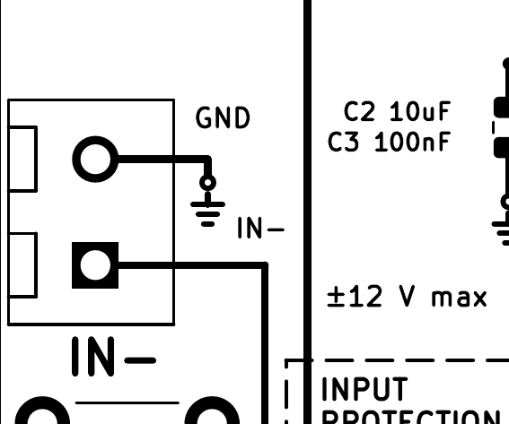
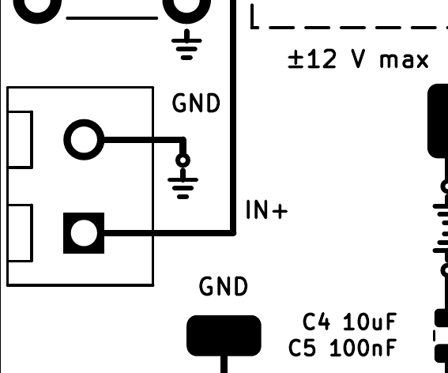
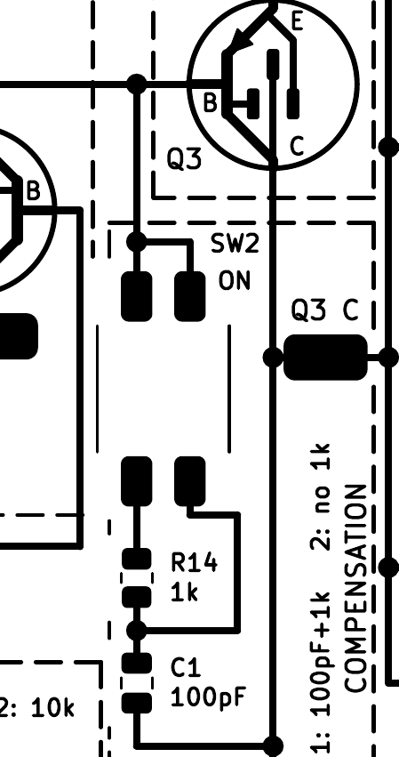
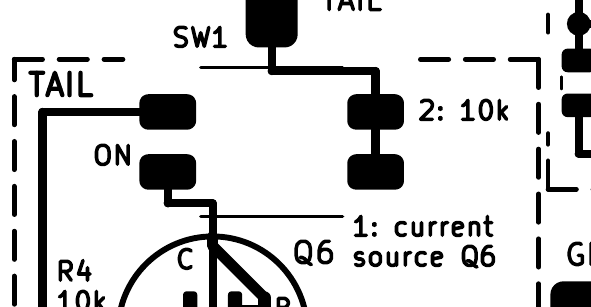
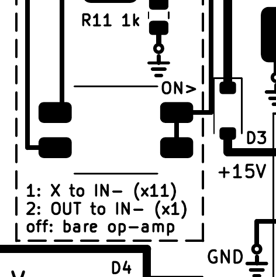
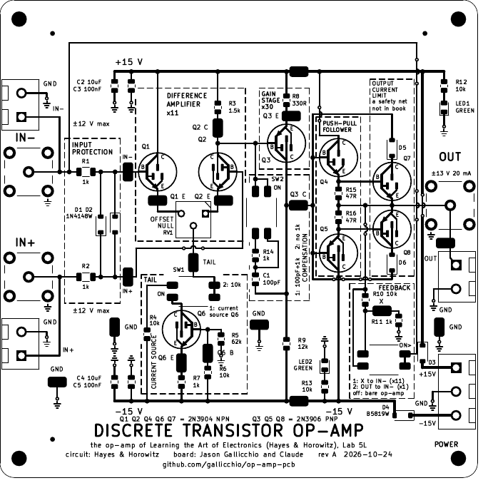
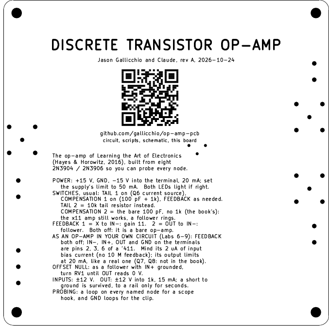
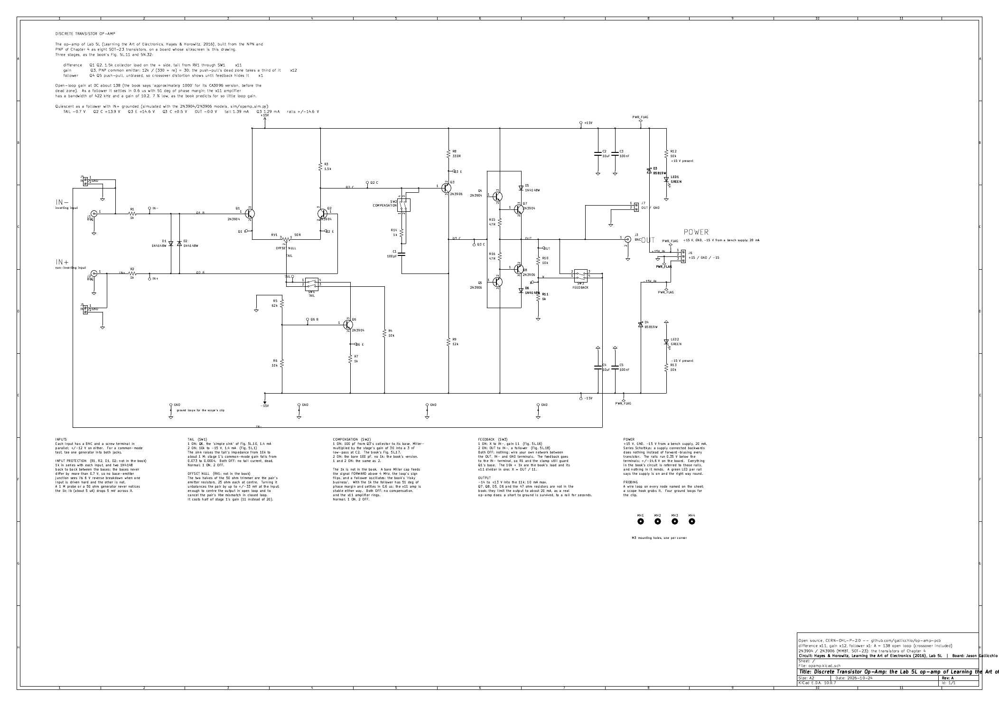

The brief's "already known" section now says what was fixed and what is still open, so
the other reviewers verify rather than re-find.
