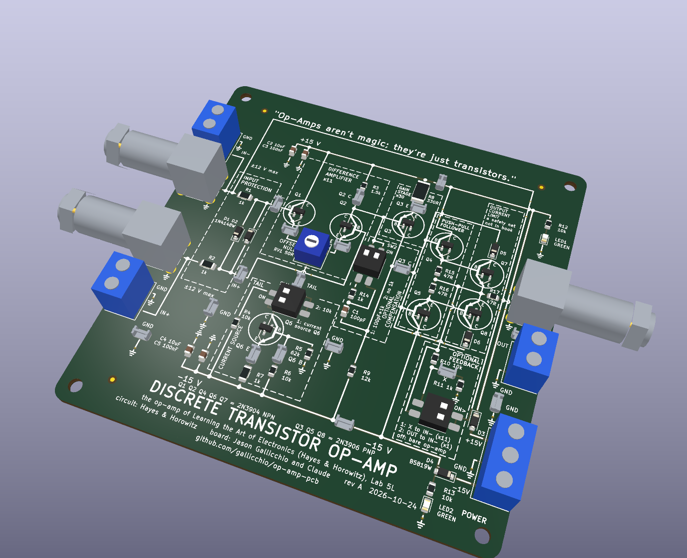
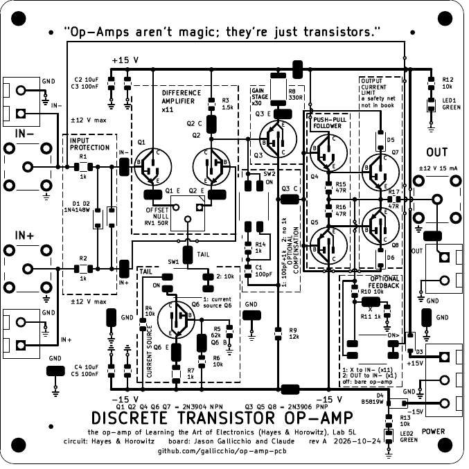
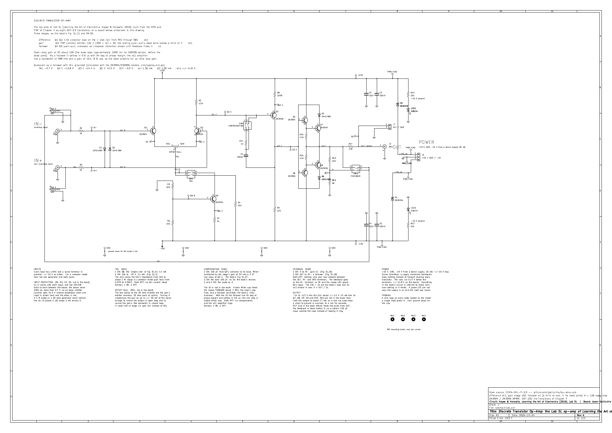

# Discrete Transistor Op-Amp

The op-amp of *Learning the Art of Electronics* (Hayes and Horowitz, 2016), Lab 5L,
built from eight 2N3904 / 2N3906 transistors on a 100 x 100 mm board whose silkscreen
*is* the schematic.  For a first electronics lab: every node has a loop to hang a
scope probe on, three DIP switches select the variants the book walks through, and
the inputs, output and power come in on BNCs and screw terminals.

> "I want you to build a relatively inexpensive educational Op-Amp PCB out of discrete
> transistors that I'll order from JLCPCB using only components that they have
> available and in stock ... The silkscreen should look exactly like the schematic ...
> The primary goal is clarity, simplicity, educational value, and ease of use for
> students in their first electronics lab class after having done most of chapter 4
> in Learning the Art of Electronics."



**Only prompts.** The whole project came from [a conversation with Claude](CLAUDE_CODE_CHAT.md):
the schematic, the board, the simulation, the fab files and these documents are all
written by the Python under `scripts/` and `sim/`, and nothing was drawn by hand.



## What it is

The book's three-stage op-amp, with the book's values:

* **Difference amplifier**, Q1 and Q2, 1.5 k collector load, gain about 11.
* **Tail**: Q6 as a current sink (62 k / 10 k / 1 k), or the plain 10 k resistor the
  book starts with, on switch **TAIL**.
* **Gain stage**: Q3, a PNP common-emitter stage, 330 ohm / 12 k, gain about 30, with
  the 100 pF Miller compensation capacitor on switch **COMPENSATION**.
* **Push-pull emitter follower**, Q4 and Q5, into the book's 10 k / 1 k divider whose
  tap **X** is the feedback point for a gain of 11.
* An **output current limit** in its own box, two more transistors and two diodes the
  way a 741 does it, so a shorted output is survived.  It is marked as the safety net
  it is and changes nothing about how the circuit works.
* Switch **FEEDBACK** closes the loop as the x11 amplifier (X to IN-) or as a follower
  (OUT to IN-), or leaves it open so you wire your own feedback through the
  screw terminals.

What the board adds, so a class of first-year students can use it:

* An **OFFSET NULL** trimmer between the two emitters (50 ohm, wiper to the tail).
* A **1 k in series with the 100 pF**, which cancels the Miller zero and makes the
  follower stable; COMPENSATION 2 shorts it so the book's bare 100 pF can be heard ringing.
* **Input protection**: 1 k in series with each input and anti-parallel 1N4148s between
  the bases, so no base-emitter junction ever sees its 6 V reverse breakdown.
* **Reverse-supply protection** (a Schottky in each rail) and a green LED per rail.
* 18 probe loops, four of them ground (one per scope channel), placed on every node
  the book asks you to look at.  Dashed boxes name each stage on the silkscreen, and
  every transistor sits inside its own symbol with B, C and E marked.

Parts cost about $7.82 in parts per board at JLCPCB; the fixed assembly fees make the
first board about $70 and each further one about $9, so about $15 each for 10 assembled boards.  See
[docs/MANUFACTURING.md](docs/MANUFACTURING.md).



## Using it

[docs/HANDBOOK.md](docs/HANDBOOK.md) is the student and instructor guide: how to
power it, what every switch and loop does, the quiescent voltage at every loop, the
bring-up order for a new board, and a set of exercises that follow Lab 5L stage by
stage.  The back of the board carries the short version.

## Building the files

Needs KiCad 10 (an AppImage is enough), Python 3 with `Pillow`, `pdftoppm`
(poppler-utils) for the images and, optionally, `libngspice` for the simulation.

```bash
git clone https://github.com/gallicchio/op-amp-pcb.git
cd op-amp-pcb
export KICAD_APPIMAGE=$HOME/.local/bin/kicad-10.0.7-x86_64.AppImage   # or kicad-cli on PATH
./make.py              # footprints, models, simulation, schematic, board, checks, fab files, docs
./make.py --clean      # delete everything it generates
```

The build stops on any ERC or DRC violation, on any of the 118 circuit assertions
that read the exported netlist back against the book's circuit, on a schematic text
overlap, on a fab-package problem (an order code whose JLCPCB description no longer
matches, a QR code that does not decode from the board file) and on any number in
these documents that no longer matches the build.

## Layout

```
make.py                one command builds and checks everything
scripts/parts.py       every part: value, footprint, LCSC code, stock, JLCPCB rotation
scripts/layout.py      the board: placements, the silkscreen wires, texts and boxes
scripts/gen_sch.py     writes hardware/opamp.kicad_sch
scripts/gen_pcb.py     writes hardware/opamp.kicad_pcb (copper follows the silk wires)
scripts/check_*.py     the netlist, the schematic sheet and the fab package
sim/opamp_sim.py       ngspice: operating point, loop gain, step response, swing, null
out/opamp/             gerbers, BOM, CPL (native and JLCPCB), prints, PLACEMENT_CHECKS
docs/                  MANUFACTURING, HANDBOOK, DESIGN_NOTES, images
```

## More

* [docs/DESIGN_NOTES.md](docs/DESIGN_NOTES.md): every departure from the book and why,
  the simulation numbers, the risks for a first board and the rev B list.
* [CLAUDE_CODE_CHAT.md](CLAUDE_CODE_CHAT.md): the conversation that produced it.

Circuit: Hayes and Horowitz.  Board: Jason Gallicchio and Claude.  Hardware under
CERN-OHL-P-2.0, scripts under MIT; see [LICENSE](LICENSE).
